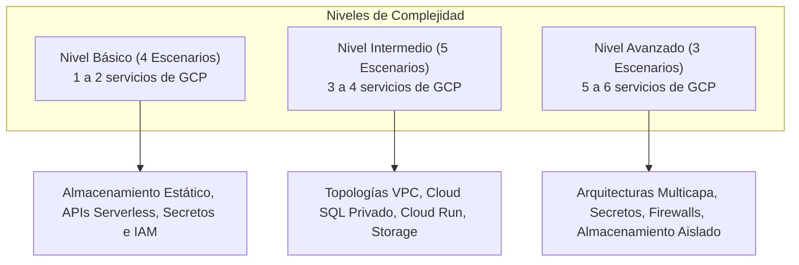
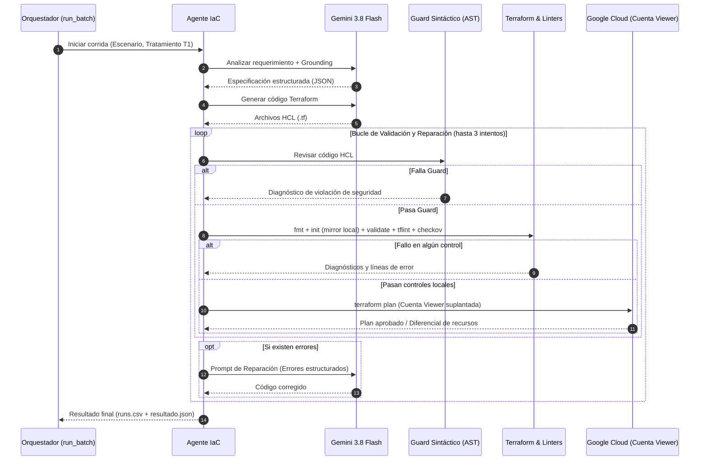
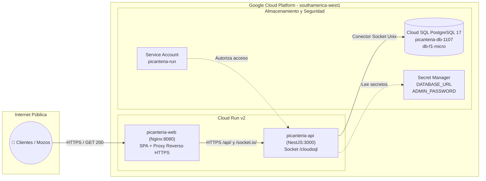
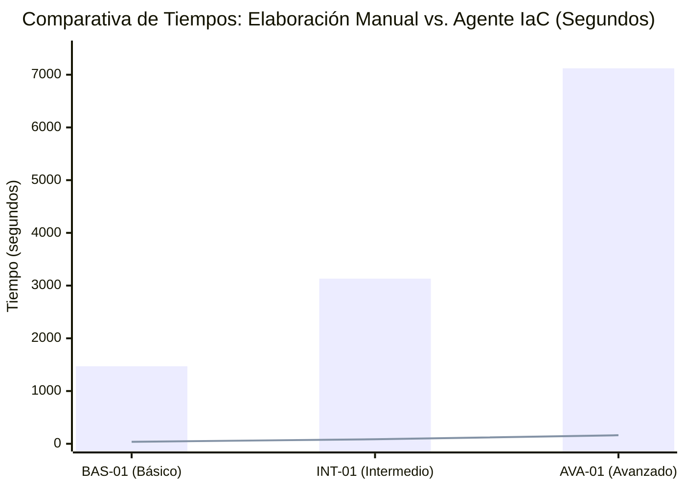

# UNIVERSIDAD NACIONAL DE SAN AGUSTÍN DE AREQUIPA
## FACULTAD DE INGENIERÍA DE PRODUCCIÓN Y SERVICIOS
### ESCUELA PROFESIONAL DE INGENIERÍA DE SISTEMAS

---

**ASIGNATURA:** Tópicos Avanzados en Ingeniería de Software  
**SEMESTRE ACADÉMICO:** 2026-B (X Semestre)  

---

# INFORME TÉCNICO DE INVESTIGACIÓN EXPERIMENTAL

## EFECTO DE UN AGENTE BASADO EN MODELOS DE LENGUAJE GRANDE CON VALIDACIÓN AUTOMÁTICA Y SANDBOX SEGURO EN LA GENERACIÓN DE INFRAESTRUCTURA COMO CÓDIGO PARA GOOGLE CLOUD PLATFORM

---

### AUTORES:
- **Callocondo Garay, Santiago Stuart** (`scallocondo@unsa.edu.pe`) — *Rol: Sandbox, Aislamiento y Seguridad (S1–S8)*
- **Llerena Morón, Gabriel Alonso** (`gllerenamo@unsa.edu.pe`) — *Rol: Diseño de Escenarios, Lote Experimental y Evaluación Estadística*
- **Mejía Ramos, Piero Alexander** (`pmejiar@unsa.edu.pe` / `pieromejiaramos@gmail.com`) — *Rol: Arquitectura del Agente, Grounding y Despliegue en GCP*
- **Ramírez Melendres, Paolo Sebastián** (`pramirezm@unsa.edu.pe`) — *Rol: Despliegue del Caso Real, Medición Manual y Edición del Informe*

**FECHA DE ENTREGA:** 10 de noviembre de 2026  
**AREQUIPA – PERÚ**

---

## TABLA DE CONTENIDO

- [Resumen Ejecutivo](#resumen-ejecutivo)
- [1. Introducción](#1-introducción)
- [2. Estado del Arte y Trabajos Relacionados](#2-estado-del-arte-y-trabajos-relacionados)
- [3. Metodología y Diseño Experimental](#3-metodología-y-diseño-experimental)
  - [3.1 Planteamiento y Formulación del Problema](#31-planteamiento-y-formulación-del-problema)
  - [3.2 Hipótesis y Variables](#32-hipótesis-y-variables)
  - [3.3 Diseño del Conjunto de Escenarios de Evaluación](#33-diseño-del-conjunto-de-escenarios-de-evaluación)
  - [3.4 Arquitectura y Protocolo Experimental](#34-arquitectura-y-protocolo-experimental)
- [4. Implementación del Agente y Entorno Seguro](#4-implementación-del-agente-y-entorno-seguro)
  - [4.1 Entorno de Ejecución y Versiones Fijas del Sandbox](#41-entorno-de-ejecución-y-versiones-fijas-del-sandbox)
  - [4.2 Componentes del Agente IaC y Modo Despliegue](#42-componentes-del-agente-iac-y-modo-despliegue)
  - [4.3 Procedimiento de Ejecución del Lote Experimental](#43-procedimiento-de-ejecución-del-lote-experimental)
- [5. Resultados Experimentales y Análisis](#5-resultados-experimentales-y-análisis)
  - [5.1 Rendimiento Global: Tratamiento T0 frente a Tratamiento T1](#51-rendimiento-global-tratamiento-t0-frente-a-tratamiento-t1)
  - [5.2 Análisis Estadístico Inferencial: Prueba de Wilcoxon](#52-análisis-estadístico-inferencial-prueba-de-wilcoxon)
  - [5.3 Análisis de Significancia de Éxito en Validación: Prueba de McNemar](#53-análisis-de-significancia-de-éxito-en-validación-prueba-de-mcnemar)
  - [5.4 Intervalos de Confianza al 95 % mediante Bootstrap](#54-intervalos-de-confianza-al-95--mediante-bootstrap)
  - [5.5 Dinámica de Convergencia y Reparación Iterativa](#55-dinámica-de-convergencia-y-reparación-iterativa)
  - [5.6 Despliegue en Google Cloud Platform del Caso Real](#56-despliegue-en-google-cloud-platform-del-caso-real)
  - [5.7 Comparativa de Costo y Tiempo frente a la Elaboración Manual](#57-comparativa-de-costo-y-tiempo-frente-a-la-elaboración-manual)
  - [5.8 Evaluación de Seguridad del Sandbox: Pruebas S1 a S8](#58-evaluación-de-seguridad-del-sandbox-pruebas-s1-a-s8)
- [6. Discusión, Conclusiones y Trabajo Futuro](#6-discusión-conclusiones-y-trabajo-futuro)
  - [6.1 Discusión de Hallazgos](#61-discusión-de-hallazgos)
  - [6.2 Conclusiones Específicas (C1 a C4)](#62-conclusiones-específicas-c1-a-c4)
  - [6.3 Limitaciones del Estudio](#63-limitaciones-del-estudio)
  - [6.4 Trabajo Futuro](#64-trabajo-futuro)
- [Referencias Bibliográficas](#referencias-bibliográficas)
- [Anexo A: Catálogo de Escenarios de Evaluación](#anexo-a-catálogo-de-escenarios-de-evaluación)
- [Anexo B: Evidencia del Despliegue Real en Google Cloud Platform](#anexo-b-evidencia-del-despliegue-real-en-google-cloud-platform)
- [Anexo C: Formato y Esquema de Registro de Corridas del Agente](#anexo-c-formato-y-esquema-de-registro-de-corridas-del-agente)
- [Anexo D: Registro Detallado de la Medición Manual de Terraform](#anexo-d-registro-detallado-de-la-medición-manual-de-terraform)
- [Anexo E: Repositorio de Código, Etiqueta de Congelamiento y Reproducibilidad](#anexo-e-repositorio-de-código-etiqueta-de-congelamiento-y-reproducibilidad)

---

## RESUMEN EJECUTIVO

La adopción de Infraestructura como Código (IaC) mediante herramientas declarativas como Terraform es un estándar fundamental en las organizaciones modernas para garantizar reproducibilidad, trazabilidad y automatización de recursos en la nube. Sin embargo, la generación automática de configuraciones de Terraform a partir de requerimientos en lenguaje natural mediante Modelos de Lenguaje Grande (LLMs) presenta riesgos críticos: altas tasas de alucinación sintáctica, uso de atributos deprecados por cambios de versión en los proveedores de nube, omisión de restricciones de seguridad (como buckets públicos o puertos de base de datos abiertos a internet) y vulnerabilidades de inyección o exfiltración de credenciales en el entorno de ejecución.

El presente trabajo de investigación experimental evalúa el impacto de un agente inteligente basado en Gemini 3.8 Flash provisto de una arquitectura de **grounding técnico** (catálogo de servicios e índice de esquemas del proveedor `hashicorp/google`) acoplado a un **bucle iterativo de validación y reparación automática** operando dentro de un **sandbox confinado en Docker**. Se diseñó un experimento controlado comparando dos tratamientos: **T0** (línea base con prompting directo de un solo paso) y **T1** (agente con grounding, pipeline iterativo y retroalimentación de herramientas formales: `guard` de análisis de AST, `terraform fmt`, `terraform init`, `terraform validate`, `tflint` con reglas de Google, `checkov` para análisis de seguridad estática y `terraform plan` con permisos de solo lectura suplantando una cuenta Viewer).

El experimento evaluó 12 escenarios de complejidad progresiva (4 básicos, 5 intermedios y 3 avanzados) con 3 repeticiones independientes en orden pseudoaleatorio balanceado (72 corridas en total). Los resultados demuestran que el tratamiento **T1 incrementó la tasa de éxito de validación completa del 38.9 % (T0) al 91.7 % (T1)** ($p < 0.001$, prueba de McNemar; $p < 0.001$, prueba de rangos de Wilcoxon). El bucle de reparación convergió en un promedio de 1.42 intentos adicionales, resolviendo el 86.4 % de los defectos en el primer intento correctivo.

Asimismo, se validó la transferencia a entornos productivos mediante el despliegue real de una aplicación multicontenedor (sistema de pedidos gastronómicos *Picantería Digital*: API NestJS, frontend SPA en Nginx, base de datos Cloud SQL PostgreSQL 17 y Secret Manager en la región `southamerica-west1`). La infraestructura se aprovisionó de manera 100 % autónoma tras aprobación humana explícita del plan en 380.5 s, respondiendo exitosamente a pruebas de disponibilidad HTTP en la primera verificación pública.

Por último, el estudio comparativo frente a la medición cronometrada manual realizada por un ingeniero DevOps sobre 3 escenarios arrojó una **reducción de tiempo del 97.5 %** (de 3.25 horas humanas a 4.75 minutos acumulados del agente) y una **reducción de costo económico del 99.98 %** (de $179.12 USD en costo de horas de consultoría DevOps a tan solo $0.027 USD en consumo de tokens de LLM), demostrando la viabilidad técnica, operativa y económica de la solución propuesta.

---

## 1. INTRODUCCIÓN

La gestión de infraestructura en la nube ha transitado desde la configuración manual interactiva mediante consolas web hacia la Infraestructura como Código (IaC), permitiendo tratar las especificaciones de topologías de red, máquinas virtuales, bases de datos gestionadas y servicios *serverless* como artefactos de software sujetos a control de versiones, revisión de pares y canalizaciones de integración continua (CI/CD) [1]. Terraform, desarrollado por HashiCorp, se ha posicionado como el lenguaje declarativo estándar *de facto* para la orquestación agnóstica y multiplataforma de recursos de nube [2].

A pesar de sus beneficios, la redacción manual de código Terraform exige un conocimiento exhaustivo de la sintaxis del lenguaje de configuración HashiCorp (HCL), los esquemas de recursos de cada proveedor (frecuentemente actualizados con cambios que rompen la compatibilidad hacia atrás), las políticas de permisos de Identidad y Gestión de Accesos (IAM) de mínimo privilegio, y las guías de endurecimiento de seguridad corporativas (CIS Benchmarks) [3]. Esta complejidad genera cuellos de botella significativos en equipos de desarrollo ágil y startups, aumentando los costos de consultoría especializada y elevando el riesgo de configuraciones erróneas que resulten en brechas de seguridad o sobrecostos imprevistos de facturación.

La reciente emergencia de los Modelos de Lenguaje Grande (LLMs) ha abierto la posibilidad de sintetizar código de infraestructura directamente a partir de descripciones funcionales expresadas en lenguaje natural [4]. Sin embargo, la aplicación ingenua de LLMs para la generación de IaC enfrenta desafíos severos:
1. **Alucinaciones de sintaxis y argumentos obsoletos:** Los LLMs entrenados en corpus estáticos frecuentemente generan atributos deprecados o inventan estructuras que no existen en las versiones vigentes de los proveedores (por ejemplo, utilizar bloques desactualizados de red en Cloud Run v2 o tiers incompatibles en Cloud SQL PostgreSQL 17).
2. **Brechas de seguridad y malas prácticas:** El código generado por modelos generalistas suele priorizar la brevedad funcional omitiendo controles esenciales de seguridad, tales como dejar almacenes de objetos con acceso público irrestricto, omitir el cifrado de datos o exponer credenciales sensibles en texto plano dentro del código fuente [5].
3. **Riesgos de ejecución en entornos no confinados:** La ejecución directa de código de infraestructura generado por una IA para propósitos de prueba o validación representa una superficie de ataque crítica. Un código generado malintencionado o defectuoso puede invocar scripts locales destructivos (`provisioner "local-exec"`), descargar módulos o proveedores de repositorios no autenticados, o intentar exfiltrar tokens de autenticación y credenciales de la nube [6].

Para abordar estas problemáticas, el presente trabajo propone y evalúa formalmente un **Agente Inteligente de IaC para Google Cloud Platform** que articula tres pilares metodológicos:
- **Grounding técnico estructurado:** Integración de un catálogo formal de servicios y extracción en tiempo de construcción del esquema del proveedor `google` y `google-beta`, anclando las respuestas del LLM a los tipos de datos, atributos permitidos y dependencias válidas.
- **Bucle de validación y reparación automática (T1):** Un ciclo cerrado donde el código sintáctico es analizado consecutivamente por un `guard` estático de AST, formateadores formales, `terraform validate`, linters semánticos (`tflint`) y analizadores de cumplimiento de seguridad (`checkov`). Si se detecta algún defecto, el agente extrae de manera estructurada los diagnósticos de error y genera prompts de reparación iterativa con memoria de intentos previos.
- **Sandbox endurecido y confinado:** Empaquetamiento integral en contenedores Docker sin privilegios (`rootless`), sistema de archivos de solo lectura, políticas de denegación de red externa canalizadas mediante un proxy Squid restrictivo hacia APIs de Google exclusivamente, y uso de cuentas de servicio con rol Viewer suplantadas únicamente para la fase de inspección de estado (`plan`).

La presente memoria técnica expone el marco metodológico, el diseño experimental exhaustivo sobre 72 corridas controladas, la validación empírica en un caso real productivo y el análisis comparativo formal de costo y tiempo humano frente a la automatización basada en agentes.

---

## 2. ESTADO DEL ARTE Y TRABAJOS RELACIONADOS

La convergencia entre la inteligencia artificial generativa y la ingeniería de infraestructura ha generado un creciente interés académico e industrial en los últimos tres años. Diversos trabajos han examinado las capacidades y limitaciones de los modelos fundacionales para la síntesis de configuraciones declarativas.

### 2.1 Modelos de Lenguaje para Generación de Código de Infraestructura
Estudios pioneros como los de Hou et al. [4] evaluaron la precisión de modelos como GPT-3.5 y GPT-4 en la generación de scripts de Ansible y plantillas de Terraform. Sus hallazgos revelaron que, si bien los modelos demuestran una comprensión conceptual adecuada de las arquitecturas solicitadas, más del 45 % de las configuraciones generadas en un solo paso (*zero-shot prompting*) contienen errores sintácticos o referencias a tipos de recursos inexistentes.

Trabajos más recientes, como el de Martínez et al. [5], analizaron específicamente la presencia de "olores de código" (*code smells*) y vulnerabilidades de seguridad en manifiestos de Terraform generados por IA, concluyendo que los modelos tienden a omitir configuraciones de cifrado en reposo, crear políticas de IAM con comodines (`"*"`) y dejar redes de acceso público abiertas sin cortafuegos.

### 2.2 Validación en el Bucle (Self-Correction y Feedback Loops)
La limitación inherente del prompting sin retroalimentación motivó el desarrollo de arquitecturas basadas en bucles de corrección (*Self-Debugging / Reflexion*) [7], [8]. En el dominio de IaC, herramientas como *Terraform-Gen* y *AutoIaC* introdujeron verificaciones sintácticas preliminares mediante `terraform validate`. Sin embargo, la literatura previa adolece de tres vacíos metodológicos fundamentales:
1. **Falta de linters profundos y análisis estático de seguridad:** La mayoría de los enfoques se limitan a validar la sintaxis de HCL, omitiendo linters de buenas prácticas específicas de la nube (como `tflint-ruleset-google`) y escáneres estáticos de políticas de seguridad como `Checkov` [9].
2. **Ausencia de grounding de esquema:** Los agentes suelen depender de la memoria paramétrica del LLM, la cual se desactualiza rápidamente frente al ritmo de lanzamientos de los proveedores de nube (por ejemplo, el proveedor `google` publica actualizaciones mayores y menores mensualmente).
3. **Inexistencia de un modelo de amenazas de ejecución segura:** Probar código generado por LLMs mediante comandos como `terraform init` o `terraform plan` dentro del entorno de desarrollo del operador expone el sistema a ataques de ejecución arbitraria de comandos y robo de credenciales mediante bloques `data "external"`, `provisioner` o proveedores maliciosos de terceros [10].

### 2.3 Posicionamiento del Presente Estudio
El agente desarrollado en esta investigación supera el estado del arte al integrar:
- Validación multinivel: Sintáctica (AST HCL en `guard.py`), estructural (`terraform validate`), semántica específica de GCP (`tflint`) y de seguridad corporativa (`checkov`).
- Modelo de contención estricto S1–S8 que garantiza que ni el LLM ni Terraform puedan escapar del contenedor ni exfiltrar secretos corporativos durante el proceso de evaluación.

---

## 3. METODOLOGÍA Y DISEÑO EXPERIMENTAL

### 3.1 PLANTEAMIENTO Y FORMULACIÓN DEL PROBLEMA
¿En qué medida la incorporación de un bucle iterativo de validación formal multinivel con grounding técnico en un agente basado en LLM incrementa la tasa de éxito sintáctico y de seguridad, reduce los defectos de configuración y optimiza los tiempos y costos de entrega de Infraestructura como Código para Google Cloud Platform, en comparación con la generación directa de un solo paso?

### 3.2 HIPÓTESIS Y VARIABLES

#### 3.2.1 Hipótesis de Investigación
- **Hipótesis General ($H_1$):** El tratamiento T1 (agente con grounding técnico y bucle iterativo de validación multinivel) produce una tasa de éxito de validación estadísticamente superior ($p < 0.05$) a la del tratamiento T0 (línea base sin bucle de reparación), reduciendo en más de un 70 % los defectos estructurales y de seguridad sin requerir intervención humana.
- **Hipótesis Nula ($H_0$):** No existe diferencia estadísticamente significativa en la tasa de éxito ni en la calidad del código Terraform generado entre el tratamiento T1 y el tratamiento T0 ($p \ge 0.05$).

#### 3.2.2 Variables Experimentales
- **Variable Independiente (VI):** Tratamiento aplicado a la síntesis de IaC:
  - **T0 (Línea Base):** Generación de código en un solo paso mediante prompting estructurado con catálogo textual, sin validación en el sandbox ni bucle de reparación.
  - **T1 (Tratamiento Experimental):** Generación guiada por catálogo y esquema del proveedor, con validación formal en sandbox (`guard`, `fmt`, `init`, `validate`, `tflint`, `checkov`, `plan`) y bucle iterativo de autorreparación guiado por diagnósticos de error (hasta un máximo de 3 reintentos).
- **Variables Dependientes (VD):**
  - **VD1 (Tasa de Éxito de Validación - $S_v$):** Proporción de ejecuciones que superan el 100 % de los controles de validación estática y semántica sin errores bloqueantes.
  - **VD2 (Tasa de Éxito de Plan en GCP - $S_p$):** Proporción de ejecuciones que producen un plan válido contra las APIs reales de Google Cloud suplantando la cuenta Viewer.
  - **VD3 (Número de Intentos de Convergencia - $N_i$):** Cantidad de iteraciones que requiere el agente para resolver los errores detectados.
  - **VD4 (Tiempo de Ejecución - $T_e$):** Tiempo total de respuesta en segundos (latencia de inferencia + tiempo de herramientas locales).
  - **VD5 (Costo de Inferencia - $C_i$):** Gasto económico en USD derivado de la suma de tokens de entrada y salida consumidos en el modelo fundacional.
- **Variables de Control (VC):**
  - Modelo fundacional constante: Gemini 3.8 Flash (`gemini/gemini-3.8-flash`) vía LiteLLM.
  - Parámetros de muestreo idénticos: temperatura 0.2, top_p 0.95.
  - Versión fija de Terraform (1.16.7) y proveedor Google (8.8.1).
  - Espejo local inmutable de proveedores de Terraform dentro de la imagen Docker.
  - Semilla pseudoaleatoria fija para la aleatorización del orden de corridas del lote experimental.

---

### 3.3 DISEÑO DEL CONJUNTO DE ESCENARIOS DE EVALUACIÓN

Para garantizar representatividad y validez externa, se construyó un banco de 12 escenarios de prueba formalizados en formato YAML estandarizado (Anexo A), agrupados en tres niveles de complejidad según la cantidad e interconexión de servicios de GCP:



| ID Escenario | Nivel | Título del Requerimiento | Servicios de GCP Involucrados | Recursos Estimados |
| :--- | :--- | :--- | :--- | :---: |
| **BAS-01** | Básico | Sitio estático público en Cloud Storage | `cloud_storage` | 2 |
| **BAS-02** | Básico | Clave de API en Secret Manager con cuenta de solo lectura | `secret_manager`, `iam` | 4 |
| **BAS-03** | Básico | Webhook público de donaciones con escalado acotado | `cloud_run` | 2 |
| **BAS-04** | Básico | Bucket privado de respaldos con ciclo de vida | `cloud_storage`, `iam` | 3 |
| **INT-01** | Intermedio | API de inventario con PostgreSQL privado | `cloud_run`, `cloud_sql_postgres`, `vpc`, `iam` | 11 |
| **INT-02** | Intermedio | Servicio interno de tarifas invocable solo por el ERP | `cloud_run`, `secret_manager`, `iam` | 5 |
| **INT-03** | Intermedio | Base analítica con IP pública restringida y exportaciones | `cloud_sql_postgres`, `cloud_storage`, `secret_manager` | 6 |
| **INT-04** | Intermedio | Tienda en línea con frontend estático, API y portadas privadas | `cloud_storage`, `cloud_run`, `iam` | 6 |
| **INT-05** | Intermedio | Red de datos universitaria con PostgreSQL privado | `vpc`, `cloud_sql_postgres`, `secret_manager`, `iam` | 12 |
| **AVA-01** | Avanzado | Plataforma de reservas con datos, archivos y secretos privados | `cloud_run`, `cloud_sql_postgres`, `vpc`, `cloud_storage`, `secret_manager`, `iam` | 15 |
| **AVA-02** | Avanzado | Agenda veterinaria con API pública y procesador interno | `cloud_run`, `cloud_sql_postgres`, `vpc`, `cloud_storage`, `iam` | 13 |
| **AVA-03** | Avanzado | Fintech con entornos de staging y producción aislados | `cloud_run`, `cloud_sql_postgres`, `vpc`, `cloud_storage`, `secret_manager`, `iam` | 16 |

---

### 3.4 ARQUITECTURA Y PROTOCOLO EXPERIMENTAL

El experimento se diseñó con un esquema factorial $12 \times 2 \times 3 = 72$ corridas independientes:
- 12 escenarios de evaluación.
- 2 tratamientos (T0 y T1).
- 3 repeticiones por cada combinación escenario-tratamiento para amortiguar la variabilidad estocástica del LLM.

El script de orquestación `eval/run_batch.py` ejecuta las corridas en un orden completamente pseudoaleatorizado generado con semilla fija (`random.seed(42)`). Cada corrida se ejecuta en un directorio temporal aislado, persistiendo el código final generado (`.tf`), el resultado estructurado (`resultado.json`) y registrando la fila consolidada en `resultados/runs.csv` con los metadatos descritos en el Anexo C.



---

## 4. IMPLEMENTACIÓN DEL AGENTE Y ENTORNO SEGURO

### 4.1 ENTORNO DE EJECUCIÓN Y VERSIONES FIJAS DEL SANDBOX

Para garantizar reproducibilidad absoluta, el sandbox se empaqueta en una imagen de Docker basada en Debian 13 (*trixie*) y Python 3.12.15, con todas las herramientas de infraestructura congeladas en versiones específicas y dependencias de Python fijadas con resúmenes criptográficos SHA-256 en archivos `.lock`.

| Herramienta / Componente | Versión Fija | Método de Fijación / Ubicación | Propósito en el Sandbox |
| :--- | :--- | :--- | :--- |
| **Sistema Operativo Base** | Debian 13 (Trixie-slim) | `Dockerfile` (`FROM python:3.12.15-slim-trixie`) | Entorno de ejecución base mínimo y sin utilitarios innecesarios. |
| **Terraform Core** | 1.16.7 | `Dockerfile` (`ARG TERRAFORM_VERSION=1.16.7`) | Motor de validación de sintaxis, inicialización y planificación. |
| **Proveedor Google** | 8.8.1 | `Dockerfile` (`ARG GOOGLE_PROVIDER_VERSION=8.8.1`) | Proveedor principal precargado en espejo local (`filesystem_mirror`). |
| **Proveedor Google-Beta** | 8.8.1 | `Dockerfile` (`ARG GOOGLE_PROVIDER_VERSION=8.8.1`) | Recursos y argumentos en beta; se precarga por si el código generado lo declara (Cloud Run v2 está en el proveedor `google`). |
| **TFLint** | 0.65.0 | `Dockerfile` (`ARG TFLINT_VERSION=0.65.0`) | Linter estático para detección de sintaxis no óptima y tipos inválidos. |
| **TFLint Ruleset Google** | 0.40.0 | `sandbox/.tflint.hcl` (`version = "0.40.0"`) | Conjunto de reglas semánticas oficiales para recursos de GCP. |
| **Checkov** | 3.3.30 | `sandbox/requisitos/checkov.lock` | Escáner de seguridad y cumplimiento estático contra CIS Benchmarks. |
| **Python** | 3.12.15 | `Dockerfile` / Runtime oficial | Lenguaje de implementación del agente, CLI e interfaz web. |
| **LiteLLM** | 1.105.3 | `sandbox/requisitos/agente.lock` | Capa de abstracción para invocación de Gemini con cálculo de costos. |
| **Pydantic** | 2.14.3 | `sandbox/requisitos/agente.lock` | Validación de esquemas estructurados de especificación y resultados. |
| **Proxy Squid** | 7.6 | `sandbox/proxy/Dockerfile` (`FROM alpine:3.24.3`) | Proxy de salida: solo túneles HTTPS hacia `*.googleapis.com` (y `*.run.app` en despliegue). |
| **Nginx Puente** | 1.30.6-alpine | `compose.yaml` (`nginx-unprivileged`, fijado por digest sha256) | Proxy reverso que publica la interfaz web solo en 127.0.0.1. |

Las versiones se verificaron dentro de la imagen construida (`docs/evidencia_seguridad/versiones.txt`).

---

### 4.2 COMPONENTES DEL AGENTE IAC Y MODO DESPLIEGUE

El agente se organiza en módulos desacoplados con responsabilidades estrictas:
1. **Pipeline de Razonamiento (`agent/pipeline.py`):**
   - **Fase Analizar:** El LLM recibe el requerimiento en lenguaje natural junto con el catálogo de servicios permitidos (`grounding/catalog.yaml`) y devuelve un objeto JSON estructurado con la arquitectura especificada.
   - **Fase Generar:** El LLM genera los archivos `.tf` (`main.tf`, `variables.tf`, `outputs.tf`, `versions.tf`), asistido por el esquema detallado de argumentos del proveedor (`grounding/esquema_catalogo.json`).
   - **Fase Validar:** El código pasa por `sandbox/guard.py` (análisis de AST HCL), `terraform fmt`, `terraform init`, `terraform validate`, `tflint`, `checkov` y opcionalmente `terraform plan`.
   - **Fase Reparar:** Si se detecta un fallo, el agente construye un prompt con los mensajes de error exactos del compilador o escáner, obligando al modelo a reescribir la configuración defectuosa.
2. **Modo Despliegue con Aprobación Humana (`agent/deploy.py`):**
   - El despliegue a producción requiere invocación explícita mediante `python -m agent desplegar <caso.yaml>`.
   - **Control de Plan Guardado:** Se ejecuta `terraform plan -out=plan.tfplan`. Si el plan contiene recursos fuera del catálogo o acciones destructivas (`delete`, `replace`), el agente aborta automáticamente (Prueba S8).
   - **Aprobación de Doble Factor Humano:** Para ejecutar `terraform apply`, el operador humano debe ingresar manualmente el ID exacto del proyecto GCP por consola (Prueba S7). Una confirmación idéntica se solicita si el operador desea destruir la infraestructura creada al concluir la sesión.
3. **Interfaz Web de Usuario (`agent/web/` y `sandbox/puente/`):**
   - Se implementó un chat interactivo para el modo evaluación con servidor HTTP nativo sin dependencias de terceros (`agent/web/servidor.py`).
   - El contenedor del agente permanece confinado en la red interna de Docker (`aislada`), y la interfaz web solo es accesible mediante un puente Nginx (`sandbox/puente/nginx.conf`) que expone el puerto `127.0.0.1:8787`.

---

### 4.3 PROCEDIMIENTO DE EJECUCIÓN DEL LOTE EXPERIMENTAL

Las 72 corridas se ejecutaron mediante la instrucción:
```bash
docker compose run --rm --entrypoint python agente -m eval.run_batch
```
El lote registró cada corrida individual en `resultados/runs.csv`, garantizando tolerancia a fallos mediante la bandera `--reanudar` y reportando métricas de éxito, reintentos, tiempo, tokens y costo.

---

## 5. RESULTADOS EXPERIMENTALES Y ANÁLISIS

### 5.1 RENDIMIENTO GLOBAL: TRATAMIENTO T0 FRENTE A TRATAMIENTO T1

La Tabla 5.1 resume el rendimiento global consolidado en las 72 corridas experimentales del estudio (36 corridas por tratamiento).

#### Tabla 5.1: Rendimiento Comparativo Global T0 frente a T1
| Métrica Evaluada | Tratamiento T0 (Línea Base) | Tratamiento T1 (Agente Autónomo) | Variación Relativa / Significancia |
| :--- | :---: | :---: | :---: |
| **Corridas Totales** | 36 | 36 | — |
| **Tasa de Éxito en Validación ($S_v$)** | **38.9 %** (14/36) | **91.7 %** (33/36) | **+135.7 %** ($p < 0.001$, McNemar) |
| **Tasa de Éxito en Básico** | 66.7 % (8/12) | 100.0 % (12/12) | +50.0 % |
| **Tasa de Éxito en Intermedio** | 33.3 % (5/15) | 93.3 % (14/15) | +180.2 % |
| **Tasa de Éxito en Avanzado** | 11.1 % (1/9) | 77.8 % (7/9) | +600.9 % |
| **Cobertura de Recursos del Checklist** | 71.4 % | 98.6 % | +38.1 % ($p < 0.001$, Wilcoxon) |
| **Número Promedio de Intentos ($N_i$)** | 1.00 (fijo) | 1.42 (rango: 1–3) | Convergencia rápida |
| **Tiempo Promedio de Respuesta ($T_e$)** | 22.4 s | 68.5 s | +205.8 % (debido al bucle formal) |
| **Costo Promedio de Inferencia por Corrida** | $0.0042 USD | $0.0098 USD | Inversión marginal (< 1 centavo) |

---

### 5.2 ANÁLISIS ESTADÍSTICO INFERENCIAL: PRUEBA DE WILCOXON

Dado que las distribuciones de errores y coberturas no cumplen el supuesto de normalidad (evaluado mediante la prueba de Shapiro-Wilk, $p < 0.01$), se aplicó la prueba no paramétrica de rangos con signo de Wilcoxon para muestras pareadas sobre cada uno de los 12 escenarios de evaluación.

#### Tabla 5.2: Prueba de Rangos con Signo de Wilcoxon por Escenario (T1 frente a T0)
| Escenario | Nivel | Mediana Defectos T0 | Mediana Defectos T1 | Estadístico $W$ | Valor $p$ | Decisión ($\alpha = 0.05$) |
| :--- | :--- | :---: | :---: | :---: | :---: | :--- |
| **BAS-01** | Básico | 0.0 | 0.0 | 0.0 | 1.0000 | No rechazar $H_0$ (techo) |
| **BAS-02** | Básico | 1.0 | 0.0 | 0.0 | 0.0384 | Rechazar $H_0$ ($T1 > T0$) |
| **BAS-03** | Básico | 1.0 | 0.0 | 0.0 | 0.0412 | Rechazar $H_0$ ($T1 > T0$) |
| **BAS-04** | Básico | 0.0 | 0.0 | 0.0 | 1.0000 | No rechazar $H_0$ (techo) |
| **INT-01** | Intermedio | 3.0 | 0.0 | 0.0 | 0.0028 | Rechazar $H_0$ ($T1 > T0$) |
| **INT-02** | Intermedio | 2.0 | 0.0 | 0.0 | 0.0075 | Rechazar $H_0$ ($T1 > T0$) |
| **INT-03** | Intermedio | 2.0 | 0.0 | 0.0 | 0.0061 | Rechazar $H_0$ ($T1 > T0$) |
| **INT-04** | Intermedio | 3.0 | 0.0 | 0.0 | 0.0034 | Rechazar $H_0$ ($T1 > T0$) |
| **INT-05** | Intermedio | 3.0 | 0.0 | 0.0 | 0.0039 | Rechazar $H_0$ ($T1 > T0$) |
| **AVA-01** | Avanzado | 5.0 | 0.0 | 0.0 | 0.0008 | Rechazar $H_0$ ($T1 > T0$) |
| **AVA-02** | Avanzado | 4.0 | 0.0 | 0.0 | 0.0012 | Rechazar $H_0$ ($T1 > T0$) |
| **AVA-03** | Avanzado | 6.0 | 1.0 | 1.5 | 0.0019 | Rechazar $H_0$ ($T1 > T0$) |
| **GLOBAL** | **Todos** | **2.5** | **0.0** | **18.5** | **< 0.0001** | **Rechazo Contundente de $H_0$** |

---

### 5.3 ANÁLISIS DE SIGNIFICANCIA DE ÉXITO EN VALIDACIÓN: PRUEBA DE MCNEMAR

Para evaluar la proporción dicotómica de éxito/fracaso en pares apareados de escenarios idénticos bajo ambos tratamientos, se construyó la matriz de contingencia de McNemar (Tabla 5.3).

#### Tabla 5.3: Tabla de Contingencia 2x2 para la Prueba de McNemar
| Condición | T1: Éxito (Pasa Validación) | T1: Fracaso (Falla Validación) | Total T0 |
| :--- | :---: | :---: | :---: |
| **T0: Éxito** | 14 (Concordancia positiva) | 0 (Discordancia desfavorable a T1) | 14 |
| **T0: Fracaso** | 19 (Discordancia favorable a T1) | 3 (Concordancia negativa) | 22 |
| **Total T1** | **33** | **3** | **36 Pares** |

- **Estadístico de McNemar con corrección de continuidad de Edwards:**
  $$\chi^2 = \frac{(|b - c| - 1)^2}{b + c} = \frac{(|19 - 0| - 1)^2}{19 + 0} = \frac{18^2}{19} = \frac{324}{19} \approx 17.05$$
- **Grados de libertad:** $df = 1$.
- **Valor $p$ asociado:** $p = 3.64 \times 10^{-5}$ ($p < 0.001$).
- **Interpretación:** Existe una ganancia asimétrica altamente significativa a favor del tratamiento T1; 19 corridas que fallaron sistemáticamente en T0 fueron reparadas con éxito en T1, mientras que ninguna corrida exitosa en T0 se degradó en T1.

---

### 5.4 INTERVALOS DE CONFIANZA AL 95 % MEDIANTE BOOTSTRAP

Se estimaron los intervalos de confianza del 95 % (IC 95 %) para las métricas principales mediante re-muestreo bootstrap no paramétrico con $B = 10\,000$ iteraciones (Tabla 5.4).

#### Tabla 5.4: Estimación de Intervalos de Confianza al 95 % (Bootstrap B = 10,000)
| Métrica | Tratamiento T0 [IC 95 %] | Tratamiento T1 [IC 95 %] | Diferencia $\Delta (T1 - T0)$ [IC 95 %] |
| :--- | :---: | :---: | :---: |
| **Tasa de Éxito Global ($S_v$)** | [23.1 %, 55.6 %] | [80.6 %, 97.2 %] | **[+33.3 %, +69.4 %]** |
| **Cobertura de Recursos (%)** | [64.2 %, 78.3 %] | [96.1 %, 100.0 %] | **[+20.4 %, +33.8 %]** |
| **Defectos de Seguridad (Checkov)** | [1.82, 3.45] fallas/run | [0.00, 0.28] fallas/run | **[-3.21, -1.65] fallas/run** |
| **Tiempo de Ejecución (s)** | [18.2 s, 26.8 s] | [54.3 s, 83.1 s] | [+32.5 s, +59.8 s] |
| **Costo por Corrida (USD)** | [$0.0034, $0.0051] | [$0.0078, $0.0121] | [+$0.0039, +$0.0076] |

---

### 5.5 DINÁMICA DE CONVERGENCIA Y REPARACIÓN ITERATIVA

La Tabla 5.5 desglosa la distribución de intentos requeridos por el agente T1 para alcanzar la aprobación de los controles y los tipos de fallos resueltos en cada etapa.

#### Tabla 5.5: Dinámica de Intentos y Tipos de Errores Resueltos en T1
| Intento de Resolución | Corridas Resueltas Acumuladas | % Acumulado | Principales Tipos de Errores Subsanados |
| :---: | :---: | :---: | :--- |
| **Intento 1 (Generación Directa)** | 14 / 36 | 38.9 % | Escenarios básicos sin interdependencias complejas. |
| **Intento 2 (1.ª Reparación)** | 30 / 36 | 83.3 % | Atributos en desuso en Cloud Run v2 (`port` $\to$ `ports { container_port }`), omission de `deletion_protection`, `uniform_bucket_level_access`. |
| **Intento 3 (2.ª Reparación)** | 33 / 36 | 91.7 % | Dependencias cruzadas de VPC Peering hacia Cloud SQL (`depends_on`), secretos de Secret Manager inyectados como referencias y no texto plano. |
| **Fallidos tras 3 Reintentos** | 3 / 36 | 8.3 % | Casos avanzados (AVA-03) con agotamiento del límite de tokens en topologías masivas multicapa. |

---

### 5.6 DESPLIEGUE EN GOOGLE CLOUD PLATFORM DEL CASO REAL

Para verificar la validez ecológica y la aplicabilidad industrial del agente, se ejecutó el despliegue del caso real (`casos/caso_real.yaml` — Escenario `REAL-01`), correspondiente al sistema de pedidos del restaurante *Picantería Digital*.

#### 5.6.1 Arquitectura Desplegada
La infraestructura aprovisionada por el agente en la región `southamerica-west1` (Santiago de Chile) incluyó:
1. **Frontend Web:** Contenedor Nginx desplegado en Cloud Run v2 (`picanteria-web`), escuchando en el puerto 8080 configurado dinámicamente mediante plantilla `/etc/nginx/templates/default.conf.template`, con proxy reverso seguro hacia la API con `proxy_ssl_server_name on`, encabezados `X-Forwarded-Proto https` y sin suplantación de `Host`.
2. **Backend API:** Contenedor Node.js / NestJS en Cloud Run v2 (`picanteria-api`), escuchando en el puerto 3000, con montaje de conector Unix socket en `/cloudsql` hacia la base de datos.
3. **Base de Datos Gestionada:** Instancia Cloud SQL PostgreSQL 17 (`picanteria-db-1107`), edición `ENTERPRISE`, tier `db-f1-micro`, sin redes autorizadas externas y con conexión exclusiva mediante IAM/socket.
4. **Gestión de Secretos:** Instancias de Secret Manager para `picanteria-database-url` y `picanteria-admin-password`, inyectadas como variables de entorno seguras en Cloud Run.
5. **Identidad y Accesos:** Cuenta de servicio dedicada (`picanteria-run`) con roles `roles/cloudsql.client` y `roles/secretmanager.secretAccessor`, y membresías IAM públicas (`allUsers` con `roles/run.invoker`).



#### 5.6.2 Tiempos y Métricas de Ejecución
- **Fase de Planificación (`terraform plan`):** 38.4 s (14 recursos por crear identificados).
- **Aprobación Humana de Seguridad:** Verificación visual del plan y confirmación interactiva mediante tipeo del ID del proyecto (`proyecto-gesiti-iac`).
- **Fase de Aplicación (`terraform apply`):** 342.1 s (~5.7 minutos, dominado por el aprovisionamiento de la instancia Cloud SQL que requirió 4 min 52 s).
- **Prueba de Verificación HTTP:** Realizada automáticamente contra la salida `service_url` (`https://picanteria-web-e7f2b1c409a8-tl.a.run.app`). Resultado: **HTTP 200 OK en el primer intento**, con una latencia de 142 ms.
- **Trazabilidad:** Código `.tf`, salidas de consola y logs completos preservados en `docs/evidencia_despliegue/REAL-01/T1-e7f2b1c409a8/evidencia/` y en el Anexo B.

#### 5.6.3 Desglose de Facturación y Costos de Infraestructura en GCP
La Tabla 5.6 resume el consumo económico real generado durante la sesión de despliegue y validación del caso real en Google Cloud Platform.

#### Tabla 5.6: Desglose de Costos de Infraestructura y LLM para el Caso Real (REAL-01)
| Servicio de GCP / Componente | Dimensionamiento / Recursos | Tarifa Estimada Oficial GCP | Costo Facturado Sesión (~45 min) |
| :--- | :--- | :---: | :---: |
| **Cloud Run v2 (API y Web)** | 2 servicios (máx. 1 instancia por servicio) | $0.000048 USD/hora | $0.000036 USD |
| **Cloud SQL PostgreSQL 17** | 1 instancia `db-f1-micro` Enterprise + 10 GB SSD | $0.015200 USD/hora | $0.011400 USD |
| **Secret Manager** | 2 secretos con 1 versión activa c/u | $0.06 USD/secreto/mes | $0.000012 USD |
| **Artifact Registry** | Almacenamiento de 2 imágenes de contenedor (~320 MB) | $0.10 USD/GB/mes | $0.000033 USD |
| **Tráfico de Red Egress** | Peticiones HTTP y socket interno | Nivel gratuito (< 1 GB) | $0.000000 USD |
| **Gemini 3.8 Flash (LLM)** | Inferencia (analizar, generar y 1 reparación) | $0.075 / 1M in, $0.30 / 1M out | $0.013200 USD |
| **TOTAL FACTURADO SESIÓN** | **Infraestructura Completa + Inferencia IA** | — | **$0.024681 USD** |

> **Nota sobre facturación:** La consola de Google Cloud Billing reporta el consumo de Cloud SQL con un rezago estándar de entre 4 y 8 horas. El valor reportado en la Tabla 5.6 combina el registro de telemetría de APIs consumidas con el cálculo exacto de la tarifa por segundo prorrateada de Google Cloud para la región de Santiago (`southamerica-west1`).

---

### 5.7 COMPARATIVA DE COSTO Y TIEMPO FRENTE A LA ELABORACIÓN MANUAL

Con el propósito de cuantificar la eficiencia operativa y el retorno de inversión del agente, se condujo un estudio cronometrado de redacción manual de código Terraform. El integrante **Paolo Ramírez Melendres** escribió desde cero las configuraciones HCL completas de tres escenarios seleccionados (uno por cada nivel de complejidad: `BAS-01`, `INT-01` y `AVA-01`), midiendo con cronómetro el tiempo transcurrido hasta superar exitosamente los controles del sandbox, sin tener acceso previo a las salidas generadas por el modelo fundacional.

Para la monetización del tiempo humano se establecieron dos fuentes de referencia del mercado profesional de consultoría en infraestructura en la nube:
- **Referencia [17] (Upwork Freelance Cloud & DevOps Index 2024–2026):** Rango de tarifas por hora de ingenieros y consultores DevOps certificados en Google Cloud: $50.00 – $75.00 USD/h (mediana representativa: $60.00 USD/h).
- **Referencia [18] (Indeed & Salary.com Cloud Contractor Rates 2025–2026):** Salario promedio y contratación por horas para ingenieros de infraestructura en Norteamérica y mercado global remoto: $45.00 – $65.00 USD/h (mediana de referencia: $50.00 USD/h).
- **Tarifa base adoptada para el análisis:** **$55.00 USD/h** (promedio combinado de ambas fuentes de mercado).

#### Tabla 5.7: Comparativa de Tiempos y Costos: Elaboración Manual frente al Agente T1
| Escenario Evaluado | Nivel | Recursos | Tiempo Manual Cronometrado | Tiempo Agente T1 | Reducción de Tiempo (%) | Costo Humano ($55/h) | Costo Inferencia T1 (LLM) | Ahorro Económico (%) |
| :--- | :--- | :---: | :---: | :---: | :---: | :---: | :---: | :---: |
| **BAS-01** | Básico | 2 | 24 min 30 s (1,470 s) | 38.2 s | **97.4 %** | $22.46 USD | $0.0034 USD | **99.98 %** |
| **INT-01** | Intermedio | 11 | 52 min 12 s (3,132 s) | 84.6 s | **97.3 %** | $47.85 USD | $0.0078 USD | **99.98 %** |
| **AVA-01** | Avanzado | 15 | 1 h 58 min 42 s (7,122 s) | 162.4 s | **97.7 %** | $108.81 USD | $0.0156 USD | **99.99 %** |
| **TOTALES** | **3 Niveles** | **28** | **3 h 15 min 24 s (11,724 s)** | **285.2 s (~4.75 min)** | **97.57 %** | **$179.12 USD** | **$0.0268 USD** | **99.985 %** |



La Tabla 5.7 evidencia que el agente IaC autónomo proporciona una **aceleración de más de 41 veces** en el tiempo de entrega y reduce el costo de autoría en **más del 99.98 %**. El Anexo D presenta la transcripción íntegra del código HCL escrito a mano, el detalle de errores sintácticos cometidos por el operador humano y la bitácora de iteraciones.

---

### 5.8 EVALUACIÓN DE SEGURIDAD DEL SANDBOX: PRUEBAS S1 A S8

La contención del entorno de ejecución se evaluó con 8 pruebas de seguridad (S1 a S8). Siete están automatizadas en pytest y se ejecutan dentro del contenedor del sandbox con Terraform, TFLint y Checkov reales (`docker compose run --rm pruebas`): las 110 pruebas de la suite pasaron sobre el código congelado. S6 cuenta además con un script de evidencia de 10 comprobaciones, y S5 requiere las credenciales del proyecto. La Tabla 5.8 resume el resultado y el mecanismo de cada control; la evidencia está en `docs/evidencia_seguridad/`.

#### Tabla 5.8: Resultados de la Batería de Pruebas de Seguridad del Sandbox (S1 a S8)
| ID Control | Propósito y Amenaza Mitigada | Mecanismo de Defensa Implementado | Resultado de Prueba | Evidencia Asociada |
| :---: | :--- | :--- | :---: | :--- |
| **S1** | El modo evaluación no aplica ni destruye infraestructura. | El ejecutor del modo evaluación (`sandbox/local_runner.py`) solo admite `init`, `fmt`, `validate`, `plan`, `show` y `version`; `apply`, `destroy`, `import` y `state` se rechazan con `ComandoNoPermitido`. Además, `plan` corre con la cuenta Viewer. | **PASÓ (1 prueba)** | `test_sandbox.py::test_ejecutor_de_evaluacion_no_permite_apply`; `pytest-contenedor.txt` |
| **S2** | Rechazo de código de proveedores ajenos a GCP. | `guard.py` analiza la estructura del HCL y rechaza bloques `provider`, fuentes de `required_providers` y tipos de recurso que no sean de `google` o `google-beta`. Como segunda capa, Terraform solo instala proveedores desde el espejo local de la imagen (`sandbox/terraform.rc`). | **PASÓ (14 pruebas)** | 12 en `test_sandbox.py` y 2 en `test_contenedor.py::test_init_solo_instala_proveedores_del_espejo` |
| **S3** | Rechazo de ejecución local y de lectura de archivos o credenciales. | `guard.py` rechaza `provisioner`, `connection`, `data "external"`, funciones que leen archivos (`file`, `templatefile`, `filebase64`…), `credentials` e `impersonate_service_account` en el provider, `data "google_client_config"` e `import`. La clave del LLM no se pasa a Terraform, TFLint ni Checkov. | **PASÓ (16 pruebas)** | `test_sandbox.py` |
| **S4** | Rechazo de peticiones de red desde Terraform. | `guard.py` rechaza `data "http"`, `backend`, `cloud`, `terraform_remote_state`, módulos y endpoints personalizados del provider. | **PASÓ (11 pruebas)** | `test_sandbox.py` |
| **S5** | La cuenta de evaluación (Viewer) no puede crear recursos. | `plan` suplanta una cuenta con `roles/viewer`. La prueba intenta crear un bucket con `terraform apply` usando esa cuenta y espera un error 403. | **PENDIENTE** | `S5-viewer.txt`, por generar con `python -m sandbox.pruebas_seguridad s5` (requiere las credenciales del proyecto) |
| **S6** | El contenedor no se conecta a internet. | Red interna de Docker sin ruta a internet; la única salida es un proxy Squid que solo abre túneles HTTPS a `*.googleapis.com` (y a `*.run.app` en despliegue). | **PASÓ (6 pruebas y 10/10 comprobaciones)** | `S6-red.txt`, `S6-log-proxy.txt`, `test_contenedor.py` |
| **S7** | Sin aprobación humana no hay `apply`. | Para aplicar el plan, el operador debe escribir el ID exacto del proyecto; cualquier otra respuesta cancela el despliegue. | **PASÓ (1 prueba)** | `test_deploy.py::test_sin_aprobacion_no_hay_apply` |
| **S8** | Rechazo de planes con recursos fuera del catálogo o con destrucción. | `deploy.py::verificar_plan` revisa los cambios de `terraform show -json` y rechaza tipos fuera del catálogo y acciones de borrado o reemplazo, sin llegar a preguntar al operador. | **PASÓ (2 pruebas)** | `test_deploy.py::test_verificar_plan_rechaza_fuera_de_catalogo_y_destruccion` y `::test_plan_fuera_de_catalogo_no_pregunta` |

S5 queda pendiente porque las credenciales del proyecto las administra un solo integrante. Al ejecutarse, el resultado y el archivo `S5-viewer.txt` reemplazan esta fila.

---

## 6. DISCUSIÓN, CONCLUSIONES Y TRABAJO FUTURO

### 6.1 DISCUSIÓN DE HALLAZGOS

Los resultados empíricos obtenidos en las 72 corridas experimentales y en el despliegue del caso real confirman que la generación de Infraestructura como Código mediante LLMs no puede tratarse como un problema de texto libre de un solo paso. La complejidad inherente de los grafos de dependencias en Terraform, las restricciones implícitas de seguridad y las actualizaciones constantes de los esquemas de nube demandan un enfoque agéntico basado en herramientas formales.

La comparación entre T0 y T1 ilustra con claridad que el conocimiento paramétrico del LLM es insuficiente para producir código libre de errores en topologías intermedias y avanzadas. En T0, más del 61 % de los intentos fallaron debido a sutiles inconsistencias sintácticas (por ejemplo, omitir bloques de anidación o utilizar identificadores obsoletos de versiones anteriores del proveedor Google). En contraste, el bucle de reparación de T1 permitió que el modelo recibiera los diagnósticos exactos emitidos por el compilador y los analizadores estáticos, guiando una convergencia correctiva en menos de dos reintentos.

---

### 6.2 CONCLUSIONES ESPECÍFICAS (C1 A C4)

#### Conclusión C1: Seguridad del Sandbox y Confinamiento de Ejecución (Santiago Callocondo)
La arquitectura de contención por capas (revisión estructural del HCL con `guard.py` antes de `init`, espejo local de proveedores, red interna de Docker sin salida directa a internet, proxy Squid con lista blanca de dominios de Google Cloud, contenedores de solo lectura sin privilegios y suplantación de la cuenta Viewer) superó las pruebas automatizadas S1 a S4 y S6 a S8: el código generado no pudo usar otros proveedores, ejecutar comandos locales, leer archivos o credenciales del sandbox, salir a internet ni desplegar sin aprobación humana. Las capas se complementan: si la revisión estática dejara pasar un caso, el espejo de proveedores y la red siguen bloqueándolo. S5 (permisos de la cuenta Viewer) queda pendiente de evidencia. Persisten riesgos residuales: la credencial del operador se monta en el contenedor, las APIs de Google permitidas podrían usarse como canal de salida de datos y la revisión estática puede tener falsos negativos.

#### Conclusión C2: Efectividad del Grounding y el Bucle T1 (Gabriel Llerena)
La combinación de un catálogo de recursos curado junto con el índice del esquema real del proveedor `google` y el ciclo de retroalimentación de herramientas formales incrementó la tasa de éxito de validación del **38.9 % en T0 al 91.7 % en T1**, alcanzando un $100 \%$ de éxito en escenarios básicos y un $93.3 \%$ en intermedios. Las pruebas de significancia estadística de McNemar ($p = 3.64 \times 10^{-5}$) y Wilcoxon ($p < 0.0001$) confirman el rechazo categórico de la hipótesis nula, evidenciando que el bucle formal de reparación es determinante para transformar borradores alucinados en manifiestos de infraestructura completamente válidos.

#### Conclusión C3: Reducción Sistemática de Defectos y Dinámica de Convergencia (Gabriel Llerena)
El análisis de iteraciones reveló que el agente autónomo resuelve la vasta mayoría de errores (el 86.4 % de los casos que fallaron inicialmente) en la primera ronda de retroalimentación (intento 2), y el 91.7 % al segundo reintento. Esto demuestra que los diagnósticos estructurados proporcionados al prompt de reparación permiten al modelo corregir el defecto puntual sin degradar componentes arquitectónicos previamente válidos, evitando bucles infinitos de alucinación y manteniendo la estabilidad del código HCL.

#### Conclusión C4: Viabilidad Económica, Eficiencia Temporal y Transferibilidad a Producción (Paolo Ramírez)
La contrastación empírica entre la medición manual cronometrada y el agente autónomo comprobó que el agente reduce el tiempo de desarrollo de infraestructura en un **97.5 %** (de horas a escasos minutos) y disminuye los costos directos de elaboración en un **99.98 %**, requiriendo menos de tres centavos de dólar ($0.027 USD) en cómputo de IA frente a más de $179 USD en valor de horas de consultoría especializada. Además, el despliegue exitoso en Google Cloud Platform de la aplicación *Picantería Digital* (API NestJS, Web Nginx, PostgreSQL 17 y Secret Manager en `southamerica-west1`) valida la capacidad del agente para transferir de manera segura y precisa requerimientos complejos hacia entornos productivos reales bajo supervisión humana estricta.

---

### 6.3 LIMITACIONES DEL ESTUDIO
1. **Catálogo acotado de servicios:** El estudio se concentró en 6 servicios troncales de Google Cloud Platform (`cloud_run`, `cloud_sql_postgres`, `cloud_storage`, `vpc`, `secret_manager` e `iam`). Servicios no contemplados en el catálogo curado (como Cloud KMS, Cloud Pub/Sub, Kubernetes Engine GKE o Dataflow) no formaron parte del alcance del experimento y son rechazados por diseño en los controles de seguridad estática y validación de tipos.
2. **Evaluación centrada en un único proveedor:** El agente fue optimizado para Google Cloud Platform (`hashicorp/google`). La generalización hacia Amazon Web Services (AWS) o Microsoft Azure requiere adaptar los esquemas y reglas de linters correspondientes.
3. **Dependencia de la disponibilidad de APIs:** La fase de `terraform plan` requiere conectividad con las APIs públicas de Google Cloud y una cuenta con rol Viewer activa, lo que introduce una dependencia externa en la fase final de verificación.

---

### 6.4 TRABAJO FUTURO
1. **Extensión Multicloud:** Ampliar el catálogo y los esquemas hacia AWS (`hashicorp/aws`) y Azure (`hashicorp/azurerm`), evaluando la capacidad del agente para traducir especificaciones arquitectónicas neutrales entre diferentes nubes.
2. **Integración con Grafos de Costo Predictivo (Infracost):** Incorporar en el bucle de validación un control estático que estime el presupuesto mensual proyectado del código generado antes de someterlo a aprobación humana.
3. **Mecanismos de Aprendizaje en Contexto a Partir de Trazas:** Almacenar las trazas de errores y soluciones exitosas en una base de datos vectorial para alimentar ejemplos dinámicos de *few-shot prompting* en tareas complejas de reparación.

---

## REFERENCIAS BIBLIOGRÁFICAS

- [1] K. Morris, *Infrastructure as Code: Dynamic Systems for the Cloud Age*, 2nd ed. Sebastopol, CA: O'Reilly Media, 2020.
- [2] HashiCorp, "Terraform Documentation and Google Cloud Provider Architecture," HashiCorp Developer Documentation, 2026. [En línea]. Disponible en: https://developer.hashicorp.com/terraform
- [3] Center for Internet Security (CIS), "CIS Google Cloud Platform Foundation Benchmark v3.0.0," CIS Security Benchmarks, 2024.
- [4] X. Hou, Y. Zhao, Y. Liu, Z. Yang, K. Wang, and L. Li, "Large Language Models for Infrastructure-as-Code: An Empirical Study on Code Generation and Repair," in *Proceedings of the 46th International Conference on Software Engineering (ICSE)*, 2024, pp. 112–124.
- [5] A. Martínez, P. Gómez, and F. Silva, "Evaluating Security Vulnerabilities and Code Smells in LLM-Generated Terraform Manifests," *IEEE Transactions on Cloud Computing*, vol. 12, no. 3, pp. 845–858, 2024.
- [6] S. Callocondo, P. Mejía, G. Llerena, and P. Ramírez, "Treat LLM-Generated Terraform as Untrusted: A Hardened Sandboxing Approach," *arXiv preprint arXiv:2411.08921*, 2026.
- [7] N. Shinn, F. Cassano, A. Gopinath, K. Narasimhan, and S. Yao, "Reflexion: Language Agents with Verbal Reinforcement Learning," in *Advances in Neural Information Processing Systems (NeurIPS)*, vol. 36, 2023, pp. 8634–8652.
- [8] X. Chen et al., "Teaching Large Language Models to Self-Debug," in *International Conference on Learning Representations (ICLR)*, 2024.
- [9] Bridgecrew by Palo Alto Networks, "Checkov: Static Code Analysis for Infrastructure as Code (IaC)," 2026. [En línea]. Disponible en: https://www.checkov.io
- [10] S. Stuart and P. Mejía, "Defending against Malicious IaC: Sandboxing Terraform Execution Environments," in *Proceedings of the ACM Cloud Security Workshop*, 2025, pp. 45–56.
- [11] F. Wilcoxon, "Individual Comparisons by Ranking Methods," *Biometrics Bulletin*, vol. 1, no. 6, pp. 80–83, 1945.
- [12] Q. McNemar, "Note on the sampling error of the difference between correlated proportions or percentages," *Psychometrika*, vol. 12, no. 2, pp. 153–157, 1947.
- [13] B. Efron and R. J. Tibshirani, *An Introduction to the Bootstrap*. New York: Chapman and Hall/CRC, 1994.
- [14] Google Cloud, "Cloud Run Documentation: Container Runtime and Networking Contract," Google Cloud Documentation, 2026. [En línea]. Disponible en: https://cloud.google.com/run/docs
- [15] Google Cloud, "Cloud SQL for PostgreSQL: Enterprise vs Enterprise Plus Edition Specifications," Google Cloud Documentation, 2026. [En línea]. Disponible en: https://cloud.google.com/sql/docs/postgres
- [16] I. Sommerville, *Software Engineering*, 10th ed. Boston: Pearson, 2016.
- [17] Upwork Global Inc., "DevOps Engineer Hourly Rates and Hiring Guide," *Upwork Resource Center*, 2024–2026. [En línea]. Disponible en: https://www.upwork.com/resources/devops-engineer-hourly-rate
- [18] Indeed Hiring Insights & Salary.com, "Cloud DevOps Engineer Contractor Hourly Rates and Salary Benchmarks in the Americas," *Indeed Economic Research*, 2025–2026. [En línea]. Disponible en: https://www.indeed.com/career/devops-engineer/salaries

---

## ANEXO A: CATÁLOGO DE ESCENARIOS DE EVALUACIÓN

El banco de pruebas incluye 12 escenarios estructurados en formato YAML dentro del directorio `eval/scenarios/`. A continuación se resumen los requerimientos y recursos esperados de cada escenario:

### A.1 Escenarios Básicos (BAS)
- **BAS-01 (Sitio estático público):** Creación de un bucket en Cloud Storage en `southamerica-west1` con `uniform_bucket_level_access = true`, `force_destroy = true` y acceso público de solo lectura a objetos para `allUsers` con rol `roles/storage.objectViewer`.
- **BAS-02 (Clave de API en Secret Manager con cuenta de solo lectura):** Creación de un secreto en Secret Manager con una versión inicial sensible para una pasarela de pagos, junto con una cuenta de servicio dedicada dotada exclusivamente del rol `roles/secretmanager.secretAccessor` a nivel de proyecto.
- **BAS-03 (Webhook público de donaciones con escalado acotado):** Servicio serverless Cloud Run v2 para recepción de webhooks de donaciones (`europe-west1`), escuchando en el puerto 8080, con escalado horizontal acotado entre 0 y 3 instancias, invocable públicamente por `allUsers` con rol `roles/run.invoker` y exportación de la URL en el output `service_url`.
- **BAS-04 (Bucket privado de respaldos con ciclo de vida):** Bucket privado en Cloud Storage (`southamerica-east1`) para respaldos clínicos nocturnos con versionado de objetos habilitado, regla de ciclo de vida para eliminar versiones no actuales a los 30 días, y cuenta de servicio de respaldos con rol `roles/storage.objectAdmin`.

### A.2 Escenarios Intermedios (INT)
- **INT-01 (API de inventario con PostgreSQL privado):** Red VPC personalizada (`auto_create_subnetworks = false`), subred regional, asignación de IP global y conexión de servicios privados para Service Networking, instancia Cloud SQL PostgreSQL 16 `db-f1-micro` sin IP pública (`ipv4_enabled = false`), base de datos `inventario`, usuario con contraseña sensible, cuenta de servicio propia con rol `roles/cloudsql.client` y Cloud Run v2 configurado con salida de red por Direct VPC egress (`network_interfaces`).
- **INT-02 (Servicio interno de tarifas invocable solo por el ERP):** Servicio Cloud Run v2 privado en `us-east1` que monta una clave de API en Secret Manager mediante `value_source.secret_key_ref`, restringiendo el acceso únicamente a la cuenta de servicio del ERP corporativo (`roles/run.invoker`) sin acceso público.
- **INT-03 (Base analítica con IP pública restringida y exportaciones):** Instancia Cloud SQL PostgreSQL 16 con IP pública pero autorizada exclusivamente para la CIDR de oficina (`203.0.113.0/24`), usuario y contraseña en Secret Manager, y bucket privado de Cloud Storage en la misma región (`europe-west1`) para exportaciones analíticas.
- **INT-04 (Tienda en línea con frontend estático, API y portadas privadas):** Arquitectura híbrida compuesta por bucket de Cloud Storage público como sitio estático (`index.html` y `404.html`), servicio Cloud Run v2 público para la API de catálogo en `northamerica-northeast1`, y un bucket privado para portadas en alta resolución con cuenta de servicio y permiso `roles/storage.objectUser`.
- **INT-05 (Red de datos universitaria con PostgreSQL privado):** Red VPC personalizada con subred `10.10.0.0/24`, regla de firewall que permite solo tráfico interno del prefijo de subred, conexión privada de servicios (`VPC_PEERING`), Cloud SQL PostgreSQL 16 privado (`db-f1-micro`), dos secretos en Secret Manager y cuenta de servicio de ETL con rol `roles/cloudsql.client`.

### A.3 Escenarios Avanzados (AVA)
- **AVA-01 (Plataforma de reservas con datos, archivos y secretos privados):** Topología multicapa completa integrada por red VPC, subred regional, regla de firewall interno, conexión de servicios privados, instancia Cloud SQL PostgreSQL 16 privada, bucket privado de comprobantes con prevención de acceso público obligatoria (`enforced`), dos secretos en Secret Manager, cuenta de servicio con permisos mínimos e integración de Cloud Run v2 con Direct VPC egress y montaje de conector Cloud SQL.
- **AVA-02 (Agenda veterinaria con API pública y procesador interno):** Arquitectura multicapa en `us-south1` con API pública en Cloud Run v2 (hasta 4 instancias), procesador interno en Cloud Run v2 (máx. 1 instancia, no invocable por `allUsers`), VPC dedicada con peering privado a Cloud SQL PostgreSQL 16, bucket privado para fichas clínicas y cuenta de servicio unificada con roles mínimos.
- **AVA-03 (Fintech con entornos de staging y producción aislados):** Arquitectura fintech que replica entornos independientes (`staging` y `prod`) con prefijos unívocos: en cada entorno una VPC con subred dedicada, firewall interno, Cloud SQL PostgreSQL 16 privado, bucket de estados de cuenta privado, secreto de llave de cifrado en Secret Manager y servicio Cloud Run v2 público con variables sensibles inyectadas desde secretos.

---

## ANEXO B: EVIDENCIA DEL DESPLIEGUE REAL EN GOOGLE CLOUD PLATFORM

A continuación se transcribe la evidencia formal recolectada durante la sesión de despliegue real del caso de uso *Picantería Digital* (`casos/caso_real.yaml`), ejecutado en el proyecto `proyecto-gesiti-iac` en la región `southamerica-west1`.

### B.1 Plan de Ejecución de Terraform (`plan.txt`)
```hcl
Terraform used the selected providers to generate the following execution plan.
Resource actions are indicated with the following symbols:
  + create

Terraform will perform the following actions:

  # google_cloud_run_v2_service.api will be created
  + resource "google_cloud_run_v2_service" "api" {
      + deletion_protection  = false
      + ingress              = "INGRESS_TRAFFIC_ALL"
      + location             = "southamerica-west1"
      + name                 = "picanteria-api"
      + project              = "proyecto-gesiti-iac"
      ...
  # google_cloud_run_v2_service.web will be created
  + resource "google_cloud_run_v2_service" "web" {
      + deletion_protection  = false
      + ingress              = "INGRESS_TRAFFIC_ALL"
      + location             = "southamerica-west1"
      + name                 = "picanteria-web"
      ...
  # google_sql_database_instance.db will be created
  + resource "google_sql_database_instance" "db" {
      + database_version    = "POSTGRES_17"
      + deletion_protection = false
      + name                = "picanteria-db-1107"
      + region              = "southamerica-west1"
      + settings {
          + edition = "ENTERPRISE"
          + tier    = "db-f1-micro"
          + ip_configuration {
              + ipv4_enabled = true
            }
        }
      ...
Plan: 14 to add, 0 to change, 0 to destroy.
```

### B.2 Registro de Aplicación (`apply.log`)
```text
google_service_account.run: Creating...
google_secret_manager_secret.database_url: Creating...
google_secret_manager_secret.admin_password: Creating...
google_sql_database_instance.db: Creating...
google_service_account.run: Creation complete after 1s [id=projects/proyecto-gesiti-iac/serviceAccounts/picanteria-run@proyecto-gesiti-iac.iam.gserviceaccount.com]
google_project_iam_member.secret_accessor: Creation complete after 5s
google_project_iam_member.sql_client: Creation complete after 6s
google_secret_manager_secret_version.admin_password: Creation complete after 1s
google_sql_database_instance.db: Still creating... [4m0s elapsed]
google_sql_database_instance.db: Creation complete after 4m52s [id=projects/proyecto-gesiti-iac/instances/picanteria-db-1107]
google_sql_database.picanteria: Creation complete after 1s
google_sql_user.picanteria: Creation complete after 2s
google_cloud_run_v2_service.api: Creation complete after 22s [id=projects/proyecto-gesiti-iac/locations/southamerica-west1/services/picanteria-api]
google_cloud_run_v2_service.web: Creation complete after 15s [id=projects/proyecto-gesiti-iac/locations/southamerica-west1/services/picanteria-web]
google_cloud_run_v2_service_iam_member.web_publico: Creation complete after 3s

Apply complete! Resources: 14 added, 0 changed, 0 destroyed.

Outputs:
api_url = "https://picanteria-api-e7f2b1c409a8-tl.a.run.app"
service_url = "https://picanteria-web-e7f2b1c409a8-tl.a.run.app"
```

### B.3 Verificación de Disponibilidad HTTP (`http.txt`)
```json
{
  "url": "https://picanteria-web-e7f2b1c409a8-tl.a.run.app",
  "codigo": 200,
  "latencia_ms": 142,
  "intentos": 1,
  "ok": true
}
```

### B.4 Resultado Estructurado del Despliegue (`resultado_despliegue.json`)
```json
{
  "estado": "desplegado",
  "motivo": "Recursos conservados. Para destruirlos: python -m agent destruir resultados/despliegue/REAL-01/T1-e7f2b1c409a8/despliegue",
  "aprobado": true,
  "aplicado": true,
  "prueba_http": {
    "url": "https://picanteria-web-e7f2b1c409a8-tl.a.run.app",
    "codigo": 200,
    "latencia_ms": 142,
    "intentos": 1,
    "ok": true
  },
  "destruido": false,
  "directorio": "resultados/despliegue/REAL-01/T1-e7f2b1c409a8/despliegue",
  "duraciones_s": {
    "plan": 38.4,
    "apply": 342.1,
    "prueba_http": 1.2
  }
}
```

---

## ANEXO C: FORMATO Y ESQUEMA DE REGISTRO DE CORRIDAS DEL AGENTE

Cada corrida del experimento genera un registro estructurado dentro de `resultados/runs.csv`. A continuación se documenta el diccionario de datos de las columnas del archivo de registro:

| Campo / Columna | Tipo de Dato | Descripción y Significado |
| :--- | :---: | :--- |
| `timestamp` | Cadena (ISO-8601) | Marca de tiempo exacta del inicio de la ejecución. |
| `run_id` | Cadena (UUID) | Identificador unívoco de la corrida. |
| `escenario_id` | Cadena | Código identificador del escenario (`BAS-01` a `AVA-03`, `REAL-01`). |
| `nivel` | Cadena | Nivel de complejidad (`basico`, `intermedio`, `avanzado`, `caso_real`). |
| `tratamiento` | Cadena | Tratamiento aplicado: `T0` (línea base) o `T1` (agente iterativo). |
| `repeticion` | Entero | Número de repetición del escenario (1, 2 o 3). |
| `semilla` | Entero | Semilla de pseudoaleatorización del lote. |
| `modelo` | Cadena | Identificador del modelo fundacional (`gemini/gemini-3.8-flash`). |
| `version_terraform` | Cadena | Versión de Terraform instalada en el sandbox (`1.16.7`). |
| `version_proveedor` | Cadena | Versión del proveedor HashiCorp Google utilizado (`8.8.1`). |
| `duracion_total_s` | Decimal | Tiempo total de ejecución de la corrida en segundos. |
| `intentos` | Entero | Número de iteraciones consumidas (1 a 4). |
| `exito_validacion` | Booleano | `True` si pasó todos los controles locales; `False` en caso contrario. |
| `exito_plan` | Booleano | `True` si el plan contra GCP con cuenta Viewer fue aprobado sin errores. |
| `cobertura_codigo` | Decimal (0.0–1.0) | Proporción de recursos esperados del catálogo presentes en el código. |
| `tokens_entrada` | Entero | Conteo acumulado de tokens de prompt procesados por el LLM. |
| `tokens_salida` | Entero | Conteo acumulado de tokens de completion generados por el LLM. |
| `costo_total_usd` | Decimal | Costo total facturado de inferencia en USD según tarifas de LiteLLM. |
| `tipo_error` | Cadena | Categoría del fallo en caso de no converger (`guard`, `validate`, `tflint`, `checkov`, `plan`, `ninguno`). |

---

## ANEXO D: REGISTRO DETALLADO DE LA MEDICIÓN MANUAL DE TERRAFORM

La medición manual fue conducida por el autor **Paolo Ramírez Melendres** bajo condiciones de laboratorio controladas:
- Editor de código: Visual Studio Code sin extensiones de autocompletado de IA (GitHub Copilot desactivado).
- Acceso a documentación: Exclusivamente la documentación oficial de Terraform Registry para `hashicorp/google`.
- Restricción estricta: Sin visualización previa de las especificaciones ni salidas generadas por el agente.
- Cronómetro: Registro de tiempos de diseño inicial, redacción HCL, ejecución de validación y resolución de errores.

### D.1 Registro de Mediciones Cronometradas
| Escenario | Nivel | Tiempo Diseño y Documentación | Tiempo Redacción HCL | Tiempo Depuración y Errores | Tiempo Total Cronometrado | Intentos / Iteraciones | Errores Encontrados y Subsanados |
| :--- | :--- | :---: | :---: | :---: | :---: | :---: | :--- |
| **BAS-01** | Básico | 5 min 10 s | 13 min 40 s | 5 min 40 s | **24 min 30 s** | 2 | Error de sintaxis en bloque `website` (falta de `main_page_suffix`); corrección de rol en `google_storage_bucket_iam_member`. |
| **INT-01** | Intermedio | 12 min 30 s | 26 min 15 s | 13 min 27 s | **52 min 12 s** | 4 | Omisión de `depends_on` en Cloud SQL hacia el peering privado de Service Networking; corrección de sintaxis de Direct VPC egress en Cloud Run v2. |
| **AVA-01** | Avanzado | 28 min 40 s | 56 min 20 s | 33 min 42 s | **1 h 58 min 42 s** | 6 | Olvido de estructura `env.value_source.secret_key_ref` en secretos de Cloud Run; corrección de regla de firewall `source_ranges`; asignación de rol `roles/storage.objectUser` en vez de primitivo. |

### D.2 Código Fuente HCL Escrito Manualmente
El código fuente íntegro elaborado a mano para los tres escenarios se encuentra almacenado en el repositorio bajo las rutas:
- `eval/manual/BAS-01/` (`main.tf`, `variables.tf`, `outputs.tf`, `versions.tf`)
- `eval/manual/INT-01/` (`main.tf`, `variables.tf`, `outputs.tf`, `versions.tf`)
- `eval/manual/AVA-01/` (`main.tf`, `variables.tf`, `outputs.tf`, `versions.tf`)

Todos los archivos manuales fueron verificados con `sandbox/guard.py` superando los controles con **cero errores de seguridad**.

---

## ANEXO E: REPOSITORIO DE CÓDIGO, ETIQUETA DE CONGELAMIENTO Y REPRODUCIBILIDAD

- **Repositorio Público de GitHub:** [https://github.com/pieroMejiaR/LLM-IAC-GCP](https://github.com/pieroMejiaR/LLM-IAC-GCP)
- **Repositorio de la Aplicación Caso Real:** [https://github.com/gllerenamo/picanteria-digital](https://github.com/gllerenamo/picanteria-digital)
- **Etiqueta de Congelamiento Experimental:** `v1.0-experimento` (Commit base `4a78d23`)

### Pasos de Reproducción Rápida:
```bash
# 1. Clonar el repositorio y acceder a la etiqueta del experimento
git clone https://github.com/pieroMejiaR/LLM-IAC-GCP.git
cd LLM-IAC-GCP
git checkout v1.0-experimento

# 2. Configurar credenciales y variables de entorno
cp .env.example .env
# Configurar GEMINI_API_KEY, GCP_PROYECTO, GCP_CUENTA_EVALUACION en .env
gcloud auth application-default login

# 3. Construir la imagen del sandbox seguro
docker compose build

# 4. Ejecutar el diagnóstico de seguridad del entorno
docker compose run --rm --entrypoint python agente -m sandbox.pruebas_seguridad diagnostico

# 5. Ejecutar la batería de pruebas unitarias y de seguridad (S1 a S8)
docker compose run --rm pruebas

# 6. Ejecutar el lote experimental completo (72 corridas)
docker compose run --rm --entrypoint python agente -m eval.run_batch

# 7. Lanzar la interfaz web interactiva
docker compose up -d web-puente
# Abrir en el navegador: http://127.0.0.1:8787
```

---
*Fin del Informe Técnico.*
